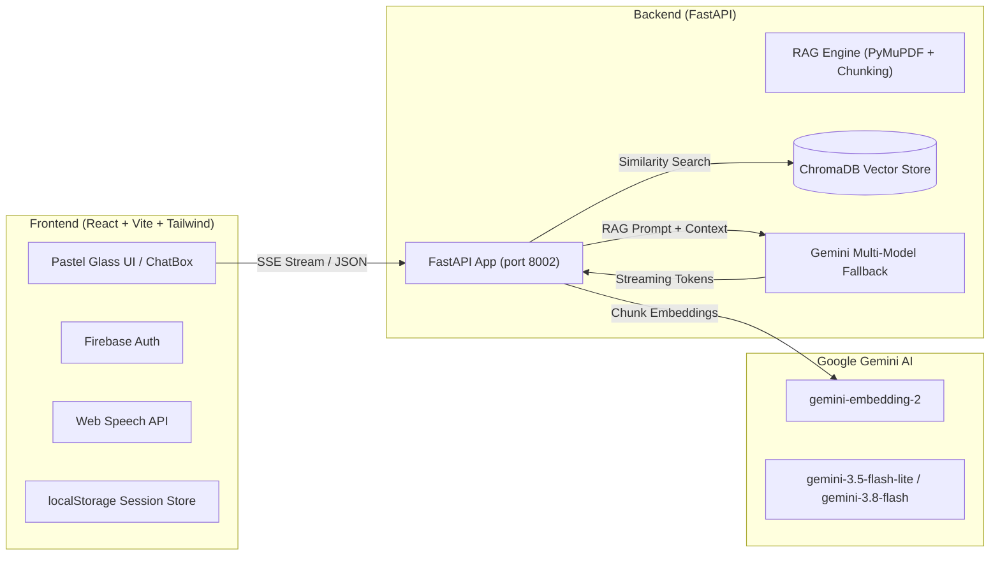

# YojanaSetu — Multilingual Civic Rights & Government Scheme Explainer

[](LICENSE)
[](https://fastapi.tiangolo.com)
[](https://ai.google.dev/)
[](https://react.dev/)
[](https://tailwindcss.com/)
[](https://firebase.google.com/)

> **YojanaSetu** (యోజన సేతు / योजना सेतु) bridges the gap between Indian citizens and complex government welfare schemes through multilingual AI, strict document-grounded RAG, and an instant interactive eligibility engine.

---

## 🌐 Live Demo & Preview

- **Live Web Application:** *(Deployment in progress)*
- **Backend API Docs:** *(Deployment in progress)*

---

## 📌 Problem Statement

Millions of eligible Indian citizens miss out on crucial central and state government welfare schemes—such as **PM-KISAN**, **Ayushman Bharat (PM-JAY)**, and national student scholarships—due to:
1. **Language Barriers:** Official government gazettes and scheme guidelines are overwhelmingly published in dense administrative English or formal Hindi.
2. **Document Opacity:** Long PDF circulars with legalese and convoluted eligibility criteria discourage common citizens.
3. **Misinformation & Intermediaries:** Citizens often fall prey to fraudulent intermediaries or inaccurate third-party information.
4. **Digital Literacy Gaps:** Navigating intricate portals, understanding income ceilings, and checking category-based qualifications is a major friction point.

**YojanaSetu** eliminates these bottlenecks by providing a unified, conversational, and completely transparent portal where citizens can query schemes in their native language, receive answers grounded strictly in official documents with page-level citations, and evaluate their eligibility with automated guidance.

---

## ✨ Key Features

### 1. 🗣️ Multilingual RAG in 5 Languages
Ask questions and receive streaming answers in **English**, **Telugu (తెలుగు)**, **Hindi (हिन्दी)**, **Tamil (தமிழ்)**, or **Kannada (ಕನ್ನಡ)**. The prompt engineering pipeline preserves official scheme nomenclature while translating operational details into accessible vernacular terms.

### 2. 📄 Page-Level PDF Citations & Evidence Grounding
Every AI response is strictly grounded in ingested official scheme guidelines via **ChromaDB** vector similarity search. The UI surfaces direct page-level badges (`Document Name, Page X`) with exact text excerpts, ensuring 100% transparency and zero hallucination.

### 3. 🎯 Interactive Eligibility Checker
Citizens can fill out a simple questionnaire (Age, Annual Income, Occupation, State, Category, Landholding) or use their saved **Citizen Profile**. YojanaSetu evaluates all indexed schemes against official criteria and categorizes them into:
- 🟢 **Eligible**: Scheme benefits, matching criteria, and exact official application steps.
- 🟡 **Potentially Eligible**: Conditional qualifications with actionable next steps.
- 🔴 **Ineligible**: Clear explanations of which constraints (e.g., income ceiling, landholding limit) disqualify the applicant.

### 4. 📤 Live Scheme PDF Ingestion & Document Manager
Users and administrators can upload new PDF circulars or scheme documents directly through the web interface. Uploaded PDFs are instantly extracted with PyMuPDF, chunked with semantic overlap, embedded with Google's `text-embedding-004`, and stored in ChromaDB without server restart.

### 5. 🎙️ Web Speech Voice Input & Audio Playback
Full accessibility support for users with limited literacy:
- **Speech-to-Text:** Tap the microphone icon to speak questions directly in regional languages.
- **Text-to-Speech:** Listen to scheme explanations with natural native audio synthesis.

### 6. 🔐 Firebase Authentication + Guest Mode
- Seamless sign-in with **Google One-Tap / OAuth** or **Email & Password**.
- **Guest Access:** Citizens can explore schemes and check eligibility immediately without signing up.
- Persistent user sessions and profile sync.

### 7. 💬 Persistent Chat History & Markdown Rendering
- Left sidebar with persistent recent chat sessions saved in `localStorage`.
- Rich markdown responses rendered with headings, structured bullet points, emphasized terms, and external portal links.
- High-resilience streaming SSE parser with automatic connection recovery.

### 8. ⚡ Multi-Model Gemini Fallback Pipeline
To ensure high availability against rate limits and transient 503/429 errors, the backend implements a resilient multi-model fallback chain:
- **Fast Mode:** `gemini-3.5-flash-lite` ➔ `gemini-3.8-flash`
- **Deep Mode:** `gemini-3.8-flash` ➔ `gemini-3.5-flash-lite`

---

## 🛠️ Architecture & Tech Stack



### Backend
- **Framework:** [FastAPI](https://fastapi.tiangolo.com/) (Python 3.11+) with asynchronous SSE streaming (`StreamingResponse`).
- **Vector Database:** [ChromaDB](https://www.trychroma.com/) for local semantic search and persistent vector embeddings.
- **Document Processing:** [PyMuPDF (fitz)](https://pymupdf.readthedocs.io/) for high-accuracy text and page extraction.
- **LLM & Embeddings:** Google [Gemini API](https://ai.google.dev/) (`google-genai` SDK) using `gemini-embedding-2` and `gemini-3.5-flash-lite` / `gemini-3.8-flash`.

### Frontend
- **Framework:** [React 18](https://react.dev/) + [Vite](https://vitejs.dev/) + [TypeScript](https://www.typescriptlang.org/).
- **Styling:** [Tailwind CSS](https://tailwindcss.com/) with a modern pastel glass aesthetic, Lucide React icons.
- **Markdown & Code:** `react-markdown` with customized responsive typography.
- **Auth:** [Firebase v10+](https://firebase.google.com/) Auth (Google Provider & Email/Password).
- **Speech:** Native Browser Web Speech API (`webkitSpeechRecognition` & `speechSynthesis`).

---

## 📂 Project Structure

```
YojanaSetu/
├── backend/
│   ├── app/
│   │   ├── __init__.py
│   │   ├── main.py          # FastAPI server, endpoints, fallback loop & SSE
│   │   ├── rag.py           # ChromaDB indexer, embeddings, retrieval logic
│   │   └── prompts.py       # Multilingual system prompts and eligibility prompt
│   ├── data/                # Preloaded official scheme PDFs (PM-KISAN, PMJAY, NSP)
│   ├── requirements.txt     # Python dependencies
│   ├── .env.example         # Template for backend secrets
│   └── chroma_db/           # Local vector store (git-ignored)
├── frontend/
│   ├── src/
│   │   ├── components/
│   │   │   ├── AuthScreen.tsx       # Firebase Login / Signup / Guest modal
│   │   │   ├── ChatBox.tsx          # Streaming chat, markdown & voice UI
│   │   │   ├── DocumentManager.tsx  # PDF upload and scheme index management
│   │   │   ├── EligibilityForm.tsx  # Dynamic eligibility evaluation form
│   │   │   ├── ProfileView.tsx      # Citizen persona configuration
│   │   │   └── SettingsView.tsx     # Language, model, & mode preferences
│   │   ├── App.tsx          # Main application layout, sidebar, recent chats
│   │   ├── api.ts           # Type-safe API client and robust SSE parser
│   │   ├── firebase.ts      # Firebase Auth initialization
│   │   ├── types.ts         # TypeScript models (ChatMessage, Citation, etc.)
│   │   └── main.tsx
│   ├── package.json
│   ├── vite.config.ts
│   ├── tailwind.config.js
│   └── .env.example         # Template for frontend Firebase & API URL
├── .gitignore
└── README.md
```

---

## 🚀 Local Development Setup

### Prerequisites
- **Python:** 3.11 or higher
- **Node.js:** 18.x or higher
- **Google Gemini API Key:** Obtainable from [Google AI Studio](https://aistudio.google.com/)
- **Firebase Project:** Create a project in [Firebase Console](https://console.firebase.google.com/) and enable Google & Email Authentication.

---

### Step 1: Clone the Repository
```bash
git clone https://github.com/manideepippagunta/YojanaSetu.git
cd YojanaSetu
```

---

### Step 2: Backend Setup
1. Navigate to the `backend` folder and create a virtual environment:
   ```bash
   cd backend
   python -m venv .venv
   ```

2. Activate the virtual environment:
   - **Windows:**
     ```bash
     .venv\Scripts\activate
     ```
   - **Linux / macOS:**
     ```bash
     source .venv/bin/activate
     ```

3. Install dependencies:
   ```bash
   pip install -r requirements.txt
   ```

4. Create `backend/.env` from the example template:
   ```bash
   cp .env.example .env
   ```
   Add your Gemini API key:
   ```env
   GEMINI_API_KEY=AIzaSy...your_actual_key
   ```

5. Start the backend server:
   ```bash
   uvicorn app.main:app --host 0.0.0.0 --port 8002 --reload
   ```
   *The server will automatically index the sample government scheme PDFs in `backend/data/` on first startup.*
   - API Health: `http://localhost:8002/api/health`
   - Interactive Docs: `http://localhost:8002/docs`

---

### Step 3: Frontend Setup
1. In a new terminal, navigate to the `frontend` directory:
   ```bash
   cd frontend
   npm install
   ```

2. Create `frontend/.env` from the example template:
   ```bash
   cp .env.example .env
   ```
   Configure your Firebase credentials and backend URL:
   ```env
   VITE_FIREBASE_API_KEY=your_firebase_api_key
   VITE_FIREBASE_AUTH_DOMAIN=your_project.firebaseapp.com
   VITE_FIREBASE_PROJECT_ID=your_project_id
   VITE_FIREBASE_STORAGE_BUCKET=your_project.firebasestorage.app
   VITE_FIREBASE_MESSAGING_SENDER_ID=your_sender_id
   VITE_FIREBASE_APP_ID=your_app_id
   VITE_API_URL=http://localhost:8002
   ```

3. Start the Vite development server:
   ```bash
   npm run dev
   ```

4. Open **http://localhost:5173** in your browser.

---

## 🧪 Production Build Verification

To verify that the frontend compiles cleanly for production:
```bash
cd frontend
npm run build
```
Build output produces optimized static assets in `frontend/dist/`.

---

## 🛡️ Security & Privacy Notice
- No citizen financial data or personal identifying documents are sent to third parties or persisted in unencrypted databases.
- All environment files containing secrets (`.env`, `backend/.env`, `frontend/.env`) are strictly excluded via `.gitignore`.
- RAG queries are restricted to official PDF schemas and standard context windows.

---

## 📜 License
This project is open-source and licensed under the [MIT License](LICENSE).
